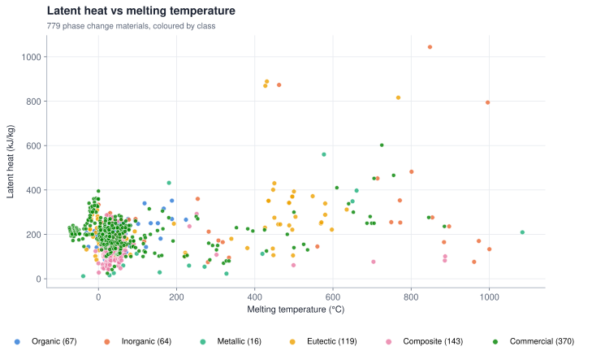
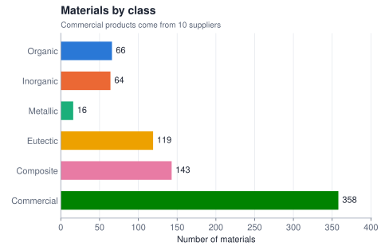
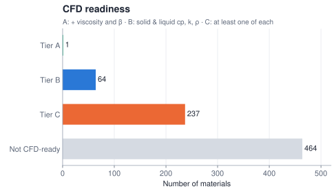
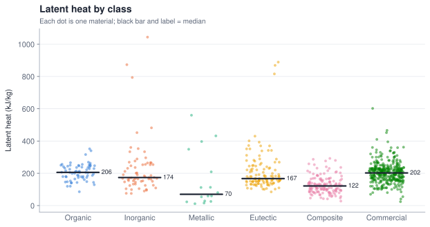
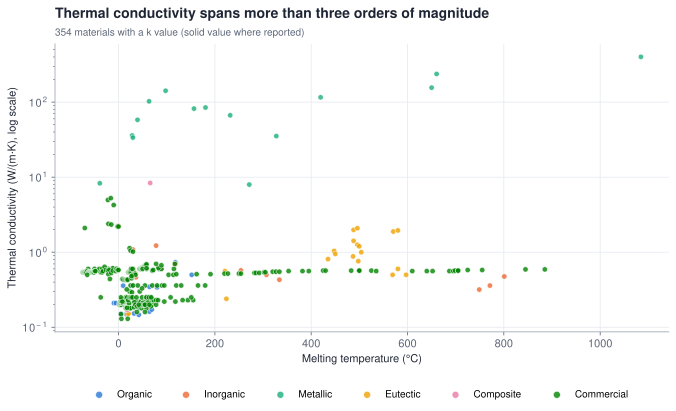
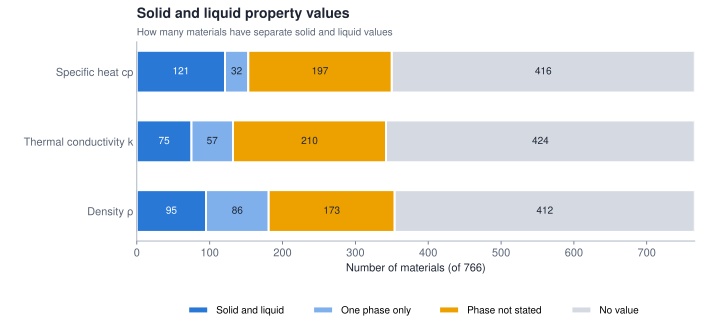

# PCM Latent Heat Storage Dataset — ML- and CFD-ready

     

A curated, machine-learning-ready dataset of **766 solid–liquid phase change materials (PCMs)** plus a separate table of **197 composite PCMs** for latent heat thermal energy storage, spanning **−74 °C to 1085 °C** and covering organics, salt hydrates, molten salts, metals, eutectics, composites and commercial products from 16 suppliers. Every row carries its source and a data-quality flag. **Solid–liquid PCMs only:** solid–solid PCMs (e.g. pentaerythritol, PlusICE X series) are excluded. Built for **machine learning**, **CFD simulation** (enthalpy–porosity models in Fluent, COMSOL, OpenFOAM) and **chemistry / materials screening**.

Compiled by **Christopher Sathya**, October 2026.

---

## Contents

| File | What it is |
|---|---|
| [`data/pcm_ml_ready_v1_7.csv`](data/pcm_ml_ready_v1_7.csv) | Full dataset: 766 rows × 52 columns, UTF-8 |
| [`data/pcm_cfd_ready_v1_7.csv`](data/pcm_cfd_ready_v1_7.csv) | CFD-ready subset: 302 materials in SI units (K, J/kg, J/(kg·K), W/(m·K), kg/m³, Pa·s, 1/K) |
| [`data/columns.csv`](data/columns.csv) | Data dictionary for the full dataset (unit, type, description) |
| [`data/columns_cfd.csv`](data/columns_cfd.csv) | Data dictionary for the CFD subset |
| [`data/pcm_composites_v1_7.csv`](data/pcm_composites_v1_7.csv) | Composite PCMs: 197 rows with base PCM, support/shell, filler, PCM loading, Tm, latent heat, conductivity, nucleating agent and supercooling |
| [`data/columns_composites.csv`](data/columns_composites.csv) | Data dictionary for the composites table |
| [`images/`](images/) | Charts shown in this README (SVG) |

---

## Dataset at a glance



<p align="center">
  
  
</p>







Median thermal conductivity by category: organics **0.21**, commercial **0.52**, inorganics **0.54**, eutectics **0.92**, composites **4.3**, metals **82 W/(m·K)**. Conductivity spans more than three orders of magnitude, which is the main design trade-off between PCM classes.

---

## For CFD users

[`data/pcm_cfd_ready_v1_7.csv`](data/pcm_cfd_ready_v1_7.csv) contains every material with at least one value each of specific heat, thermal conductivity and density, converted to SI units for direct use in enthalpy–porosity models.

| Tier | Meaning | Materials |
|---|---|---|
| **A** | Solid & liquid cp, k, ρ **+** liquid viscosity **+** thermal expansion β — ready for natural-convection (Boussinesq) simulations | 1 (n-octadecane) |
| **B** | Solid & liquid cp, k, ρ reported separately — ready for conduction-dominated models | 64 |
| **C** | At least one value of each property. A phase-unspecified value is used for both phases (165), or a value reported for only one phase is copied to the other (72). The `phase_assumed` column says which. Check these before relying on solid/liquid contrast | 237 |

Additional CFD properties in the full dataset:

- **Liquid viscosity** (`mu_liquid_mPas`) for 10 materials: n-octadecane (Faden 2019 review correlation), LiNO₃, NaNO₃, KNO₃, NaCl, KCl, NaBr (NIST reference correlations, Tasidou 2019), solar salt 60:40 (DLR 2022) and two Rubitherm paraffins (Kraiem 2019).
- **Thermal expansion β** (`beta_liquid_1K`) for 6 materials, from published density–temperature correlations.
- **Solidus / liquidus** (`T_melt_start_C`, `T_melt_end_C`) for 44 materials, from manufacturer melting ranges and DSC onset/peak.
- **Volume change on melting** (`vol_change_melting_pct`) for 95 materials, from solid and liquid densities — needed to size containers.
- **Liquid thermal conductivity** for six molten salts from NIST reference correlations (Chliatzou 2018).

Viscosity and β are still sparse. Most PCM literature reports only Tm, latent heat, cp, k and ρ; for natural-convection studies of other materials, measured viscosity is needed.

---

## Composite PCMs

[`data/pcm_composites_v1_7.csv`](data/pcm_composites_v1_7.csv) lists 197 composite PCMs from six reviews (2016–2026): porous-silica composites, carbon-filled and thermally conductive form-stable composites, microencapsulated PCMs and stabilised eutectic salt hydrates. Each row gives the base PCM, the support or shell, the filler, the PCM loading (wt%), the composite's melting temperature, latent heat and thermal conductivity where reported, the pure PCM's values for comparison, and any nucleating agent with its supercooling. The 133 composites that report both Tm and latent heat also appear in the main dataset with category `Composite`.

Values are copied from review tables (`data_status` = secondary review table). The review's reference number is kept in `review_ref`, so each value can be traced to the original paper.

---

## For chemistry and materials users

- **InChIKey and SMILES** (from PubChem) for 114 pure compounds, plus **CAS numbers** in the full workbook.
- Chemical formula, molar mass, atom counts, hydrate water count and water mass fraction for 134 compounds.
- Eutectic compositions (wt% or mol%) in the `name` / subclass fields.
- **Melting behaviour** where a source states it explicitly (e.g. Na₂SO₄·10H₂O incongruent; sodium acetate trihydrate incongruent if overheated) and literature supercooling for selected salt hydrates.
- Several materials appear with values from more than one source, so the spread of published data can be examined directly.

---

## Columns and units

Full list with units: [`data/columns.csv`](data/columns.csv). Units are also encoded in the column names (for example `_C` = °C, `_kJkg` = kJ/kg, `_WmK` = W/(m·K)).

| Group | Columns | Unit |
|---|---|---|
| Identity | `id`, `name`, `category`, `subclass` | – |
| Splitting & weighting | `group_id` | – (group label) |
| | `sample_weight` | dimensionless, 0–1 (data quality) |
| | `in_core_set` | 0/1 |
| Flags | `is_organic`, `is_inorganic`, `is_metallic`, `is_eutectic`, `is_composite`, `is_commercial`, `is_solid_solid` (all 0), `latent_is_total_storage`, `has_COOH_like` | 0/1 |
| Phase change | `Tm_C`, `cryst_T_C` | °C |
| | `supercooling_K_from_data` | K |
| | `T_melt_start_C`, `T_melt_end_C` | °C |
| | `vol_change_melting_pct` | % |
| | `melting_behaviour` | – |
| | `latent_kJkg` | kJ/kg |
| | `volumetric_MJm3` | MJ/m³ |
| Specific heat | `cp_solid_kJkgK`, `cp_liquid_kJkgK`, `cp_unspecified_kJkgK` | kJ/(kg·K) |
| Thermal conductivity | `k_solid_WmK`, `k_liquid_WmK`, `k_unspecified_WmK` | W/(m·K) |
| Density | `rho_solid_kgm3`, `rho_liquid_kgm3`, `rho_unspecified_kgm3` | kg/m³ |
| Liquid transport | `mu_liquid_mPas` | mPa·s |
| | `beta_liquid_1K` | 1/K |
| Formula descriptors | `molar_mass_gmol` | g/mol |
| | `n_atoms`, `n_C`, `n_H`, `n_O`, `n_N`, `n_halogen`, `n_metal_atoms`, `hydrate_water_n`, `C_chain_len_if_alkane` | count per formula unit |
| | `water_mass_frac` | dimensionless, 0–1 |
| Chemical identifiers | `inchikey`, `smiles`, `formula_parsed` | – |
| Provenance | `source_key`, `data_status` | – |

**Notes on specific columns:**

- `_solid` / `_liquid` = value for that phase as reported. `_unspecified` = the source gives one value without stating the phase (e.g. PlusICE, Axiotherm). Blank = not reported. **Do not fill blanks with zeros.**
- `sample_weight`: 1.0 verified / datasheet / measured · 0.9 manufacturer listing · 0.8 literature / handbook · 0.7 secondary review table.
- `latent_is_total_storage = 1`: the supplier reports heat storage capacity over a temperature range (latent + some sensible heat), not pure latent heat.
- `supercooling_K_from_data` = `Tm_C − cryst_T_C`. Small negative values occur where a datasheet prints a freezing point above the melting point; they are kept as published.

---

## Quick start

```python
import pandas as pd
from sklearn.model_selection import GroupKFold

df = pd.read_csv("data/pcm_ml_ready_v1_7.csv")

# Example: pure compounds and eutectics only, highest-quality rows first
core = df[df.in_core_set == 1]

features = ["molar_mass_gmol", "n_atoms", "n_C", "n_H", "n_O", "n_N",
            "n_halogen", "n_metal_atoms", "hydrate_water_n", "water_mass_frac",
            "is_organic", "is_inorganic", "is_metallic", "has_COOH_like"]
X, y = core[features].fillna(0), core["Tm_C"]

# Split by group_id so the same material never appears in train and test
for train, test in GroupKFold(n_splits=5).split(X, y, groups=core.group_id):
    ...

# CFD: tier A/B materials in SI units
cfd = pd.read_csv("data/pcm_cfd_ready_v1_7.csv")
print(cfd[cfd.tier.isin(["A", "B"])][["name", "T_melt_K", "latent_heat_J_per_kg",
      "rho_solid_kg_per_m3", "rho_liquid_kg_per_m3", "k_solid_W_per_mK", "k_liquid_W_per_mK"]])
```

---

## Sources

| Type | Sources |
|---|---|
| Reviews | Zalba et al. 2003; Sharma et al. 2009; Kenisarin 2010; Abhat 1983; Xie et al. 2017; Hirschey et al. 2018 (ORNL); Mao et al. 2025 |
| Measured | Müller et al. 2020, *Materials* 13, 4486 (consistent DSC method) |
| Added in v1.7 | Composites and microcapsules: Mitran et al. 2021 (*Molecules* 26, 241); Yang et al. 2019 (*Molecules* 24, 2055); *Materials* 19, 1156 (2026); Hamad et al. 2021 (*Appl. Sci.* 11, 11900); Kurdi et al. 2021 (*Materials* 14, 5328); Cervantes Ramírez et al. 2025 (*J. Compos. Sci.* 9, 667). Eutectics: Zhou et al. 2023 (*Separations* 10, 49, measured); Liu et al. 2023 (*Buildings* 13, 3043, measured); Ke 2017 via Hamad 2021; salt–water eutectics via Xie et al. 2017; Rashid et al. 2023 (*J. Compos. Sci.* 7, 338). Products: Micronal, Energain, Devan, Henkel, Rubitherm SP/GR via Kurdi 2021 |
| Open datasets (CC BY 4.0) | University of Lleida / CORA: [10.34810/data1218](https://doi.org/10.34810/data1218), [10.34810/data2156](https://doi.org/10.34810/data2156), [10.34810/data1822](https://doi.org/10.34810/data1822) |
| Property reference data | Faden et al. 2019 (*Materials* 12, 2974, n-octadecane review); Tasidou et al. 2019 and Chliatzou et al. 2018 (*J. Phys. Chem. Ref. Data*, NIST molten-salt viscosity and conductivity); Bonk & Bauer 2022 (DLR, solar salt); Serrano-López et al. 2013 (molten salts database); Lasfargues et al. 2015; Kraiem et al. 2019 |
| Melting behaviour | Hirschey et al. 2018; Prabhu et al. 2012; Liu et al. 2024 (*Nanomaterials* 14, 1077); Xie et al. 2017 |
| Chemical identifiers | PubChem (InChIKey, SMILES, CAS) |
| Handbook | NIST Chemistry WebBook / CRC Handbook. v1.6 adds condensed-phase cp near the melting point for 63 pure compounds from WebBook data and Shomate equations (Chase 1998, NIST-JANAF) |
| Manufacturer datasheets | Rubitherm, PureTemp, PCM Products (PlusICE), Croda, Axiotherm, Pluss, Phase Change Solutions (BioPCM), Insolcorp, Sasol, Cowa (plus six more suppliers via Kurdi 2021) |

Published values for the same material can differ by 10–20 %. Use `sample_weight` or filter on `data_status` when precision matters.

---

## Citation

If you use this dataset, please cite:

> Sathya, C. (2026). *PCM Latent Heat Storage Dataset — ML- and CFD-ready* (v1.7) [Data set]. GitHub. https://github.com/christophersathya-bit/PCM_latent_storage_dataset

## Licence

The dataset (all files in `data/` and the charts in `images/`) is released under the **[Creative Commons Attribution 4.0 International (CC BY 4.0)](https://creativecommons.org/licenses/by/4.0/)** licence. See [`LICENSE`](LICENSE).

You may share and adapt the data for any purpose, including commercial use, provided you give appropriate credit (see *Citation* above) and indicate if changes were made.

**Third-party content**

- Rows from the University of Lleida / CORA datasets (doi 10.34810/data1218, 10.34810/data2156, 10.34810/data1822) are themselves CC BY 4.0. Attribute those datasets as well when you reuse those rows.
- Values from published papers and handbooks are factual data cited to their source. Please also cite the original sources (listed in `source_key` and the Sources table) for any values you rely on.
- Product names and trademarks (e.g. Rubitherm, PureTemp, PlusICE, Micronal) belong to their owners. Supplier values come from public datasheets; check the current datasheet before design use.

The data is provided "as is", without warranty of any kind. Verify critical values against the original source before engineering or safety-related use.
