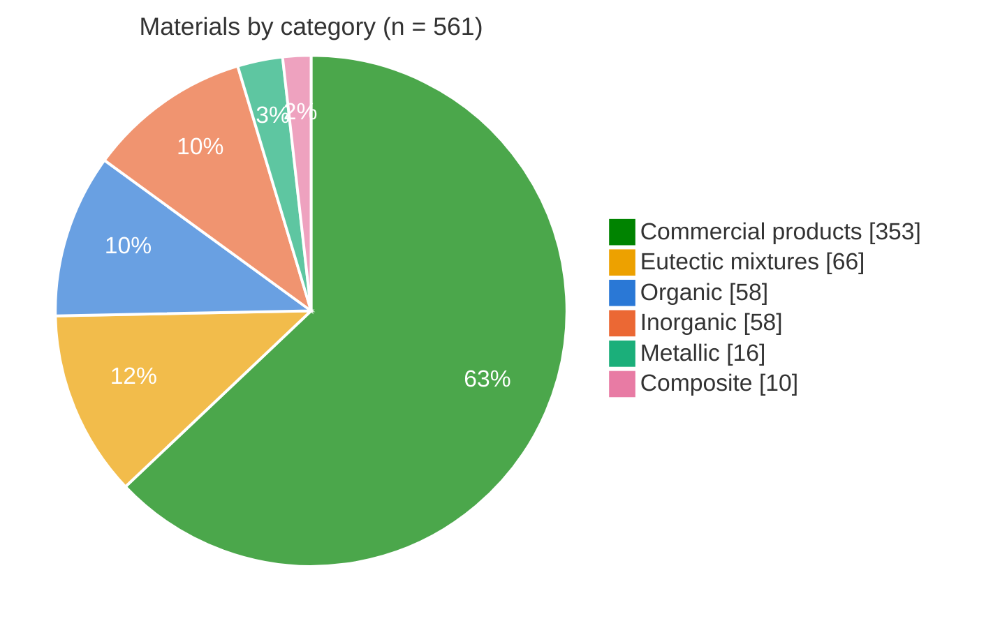
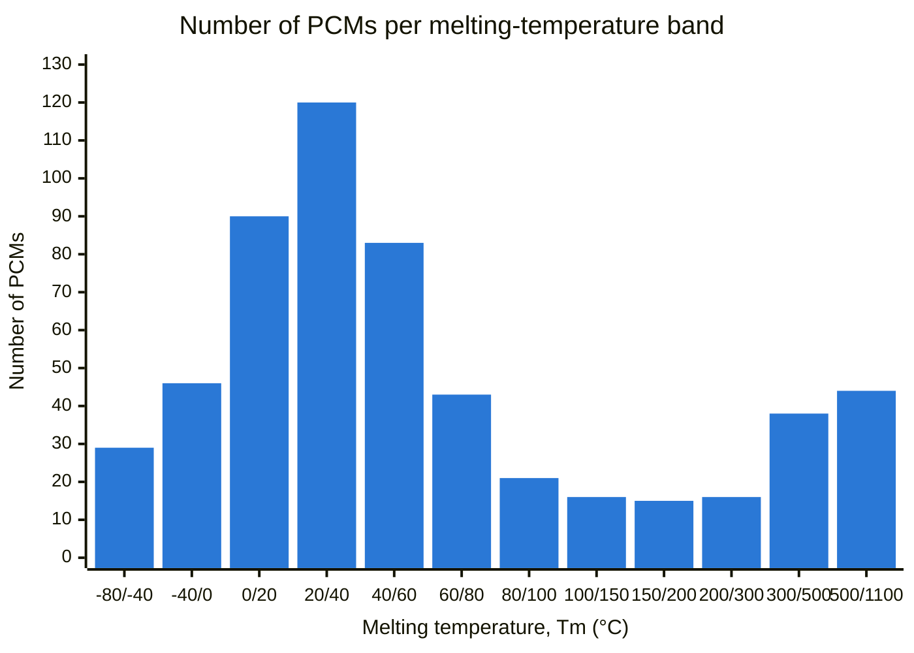
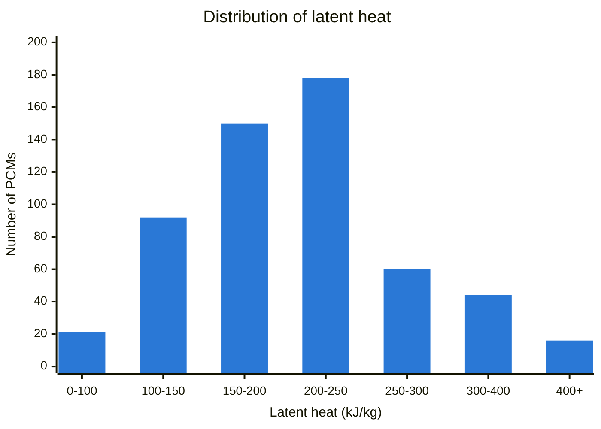
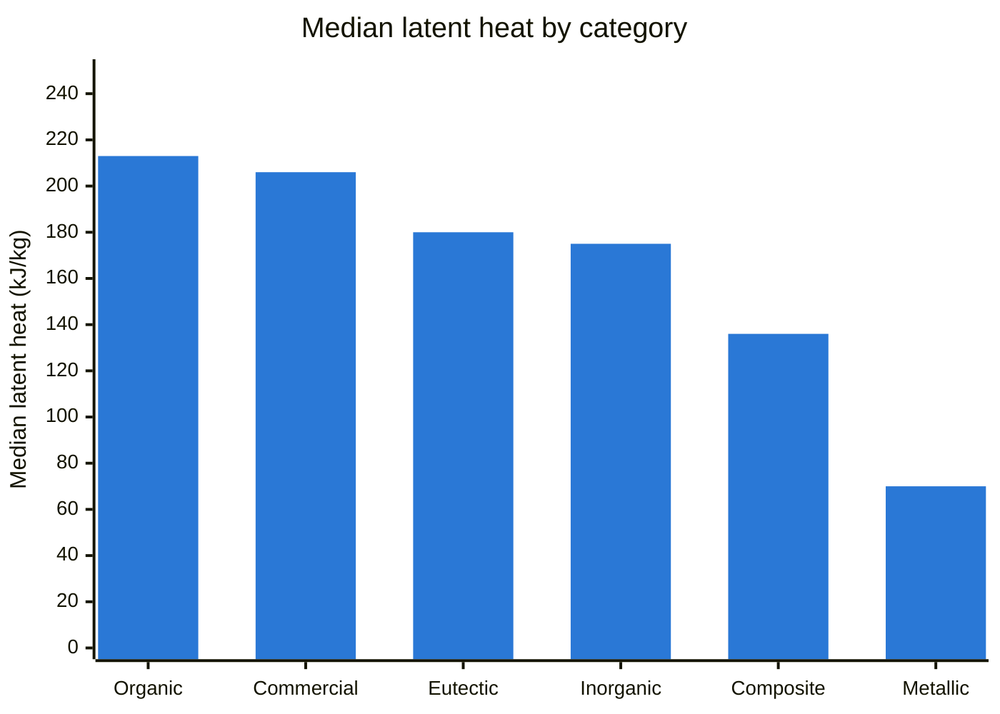
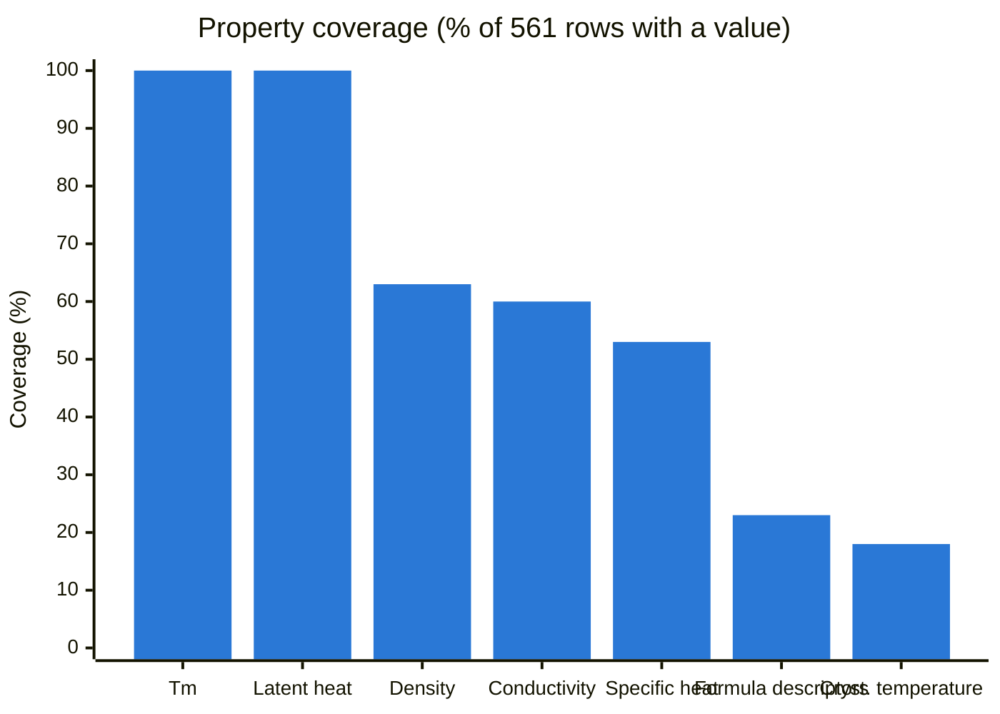

# PCM Latent Heat Storage Dataset — ML-ready

     

A curated, machine-learning-ready dataset of **561 phase change materials (PCMs)** for latent heat thermal energy storage, covering organics, salt hydrates, molten salts, metals, eutectics, composites and commercial products from 10 suppliers. Every row carries its source and a data-quality flag.

Compiled by **Christopher Sathya**, October 2026.

---

## Contents

| File | What it is |
|---|---|
| [`data/pcm_ml_ready_v1_4.csv`](data/pcm_ml_ready_v1_4.csv) | The dataset: 561 rows × 44 columns, UTF-8 |
| [`data/columns.csv`](data/columns.csv) | Data dictionary: unit, type and description of every column |

---

## Dataset at a glance











Median thermal conductivity by category: organics **0.26**, commercial **0.51**, inorganics **0.61**, eutectics **0.95**, composites **4.3**, metals **82 W/(m·K)**. Conductivity spans more than three orders of magnitude, which is the main design trade-off between PCM classes.

---

## Columns and units

Full list with units: [`data/columns.csv`](data/columns.csv). Units are also encoded in the column names (for example `_C` = °C, `_kJkg` = kJ/kg, `_WmK` = W/(m·K)).

| Group | Columns | Unit |
|---|---|---|
| Identity | `id`, `name`, `category`, `subclass` | – |
| Splitting & weighting | `group_id` | – (group label) |
| | `sample_weight` | dimensionless, 0–1 (data quality) |
| | `in_core_set` | 0/1 |
| Flags | `is_organic`, `is_inorganic`, `is_metallic`, `is_eutectic`, `is_composite`, `is_commercial`, `is_solid_solid`, `latent_is_total_storage`, `has_COOH_like` | 0/1 |
| Phase change | `Tm_C`, `cryst_T_C` | °C |
| | `supercooling_K_from_data` | K |
| | `latent_kJkg` | kJ/kg |
| | `volumetric_MJm3` | MJ/m³ |
| Specific heat | `cp_solid_kJkgK`, `cp_liquid_kJkgK`, `cp_unspecified_kJkgK` | kJ/(kg·K) |
| Thermal conductivity | `k_solid_WmK`, `k_liquid_WmK`, `k_unspecified_WmK` | W/(m·K) |
| Density | `rho_solid_kgm3`, `rho_liquid_kgm3`, `rho_unspecified_kgm3` | kg/m³ |
| Formula descriptors | `molar_mass_gmol` | g/mol |
| | `n_atoms`, `n_C`, `n_H`, `n_O`, `n_N`, `n_halogen`, `n_metal_atoms`, `hydrate_water_n`, `C_chain_len_if_alkane` | count per formula unit |
| | `water_mass_frac` | dimensionless, 0–1 |
| Provenance | `formula_parsed`, `source_key`, `data_status` | – |

**Notes on specific columns:**

- `_solid` / `_liquid` = value for that phase as reported. `_unspecified` = the source gives one value without stating the phase (e.g. PlusICE, Axiotherm). Blank = not reported. **Do not fill blanks with zeros.**
- `sample_weight`: 1.0 verified / datasheet / measured · 0.9 manufacturer listing · 0.8 literature / handbook · 0.7 secondary review table.
- `latent_is_total_storage = 1`: the supplier reports heat storage capacity over a temperature range (latent + some sensible heat), not pure latent heat.
- `supercooling_K_from_data` = `Tm_C − cryst_T_C`. Small negative values occur where a datasheet prints a freezing point above the melting point; they are kept as published.

---

## Quick start

```python
import pandas as pd
from sklearn.model_selection import GroupKFold

df = pd.read_csv("data/pcm_ml_ready_v1_4.csv")

# Example: pure compounds and eutectics only, highest-quality rows first
core = df[df.in_core_set == 1]

features = ["molar_mass_gmol", "n_atoms", "n_C", "n_H", "n_O", "n_N",
            "n_halogen", "n_metal_atoms", "hydrate_water_n", "water_mass_frac",
            "is_organic", "is_inorganic", "is_metallic", "has_COOH_like"]
X, y = core[features].fillna(0), core["Tm_C"]

# Split by group_id so the same material never appears in train and test
for train, test in GroupKFold(n_splits=5).split(X, y, groups=core.group_id):
    ...
```

---

## Sources

| Type | Sources |
|---|---|
| Reviews | Zalba et al. 2003; Sharma et al. 2009; Kenisarin 2010; Abhat 1983; Xie et al. 2017; Hirschey et al. 2018 (ORNL); Mao et al. 2025 |
| Measured | Müller et al. 2020, *Materials* 13, 4486 (consistent DSC method) |
| Open datasets (CC BY 4.0) | University of Lleida / CORA: [10.34810/data1218](https://doi.org/10.34810/data1218), [10.34810/data2156](https://doi.org/10.34810/data2156), [10.34810/data1822](https://doi.org/10.34810/data1822) |
| Handbook | NIST Chemistry WebBook / CRC Handbook |
| Manufacturer datasheets | Rubitherm, PureTemp, PCM Products (PlusICE), Croda, Axiotherm, Pluss, Phase Change Solutions (BioPCM), Insolcorp, Sasol, Cowa |

Published values for the same material can differ by 10–20 %. Use `sample_weight` or filter on `data_status` when precision matters.

---

## Citation

If you use this dataset, please cite:

> Sathya, C. (2026). *PCM Latent Heat Storage Dataset — ML-ready* (v1.4) [Data set]. GitHub. https://github.com/christophersathya-bit/pcm-latent-heat-dataset

## Licence

No licence has been chosen yet. Rows from the University of Lleida / CORA datasets are CC BY 4.0 and must be attributed. Supplier values are cited from public datasheets and remain the property of their publishers.
